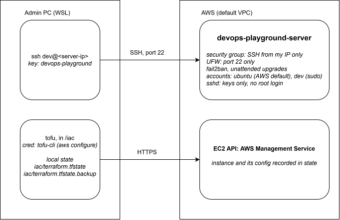

This is a DevOps project inspired from [roadmap.sh: IaC on DigitalOcean](https://roadmap.sh/projects/iac-digitalocean)

The Cloud Provider chosen for this project is AWS. So the equivalent of Droplet on DigitalOcean would be EC2 instance (Elastic Compute Cloud) on AWS.

## IaC with Opentofu
I will be using Opentofu which is a fork of Terraform for the IaC concept. Opentofu is installed on Ubuntu following the guide [Installing OpenTofu on .deb-based Linux](https://opentofu.org/docs/intro/install/deb/)

Verify the installation with `tofu version`.

## Configure AWS CLI in WSL
**In AWS Console:**

1. IAM → Users → create a user 
2. Attach permissions policy
3. Under the user → Security credentials → Create access key → select "CLI" use case
4. This gives you an Access Key ID and Secret Access Key — the only time you see the secret key

**In WSL:**

1. Run `aws configure`.

It prompts for:
- AWS Access Key ID
- AWS Secret Access Key
- Default region (e.g. `eu-central-1`)
- Default output format (e.g. `json`)

2. Verify these using:
```bash
cat ~/.aws/credentials
cat ~/.aws/config
```
## Import instead of Destroy and Recreate
During phase 1, I have created a EC2 instance for hosting the Linux server. So I have the option of removing the instance and creating a new one using IaC, which is more direct and easy. 

Or I could import the EC2 instance which would be slightly trickier but a great learning process (and make my life harder lol). From my experience, import has been a task that appear quite often during both work and interview. 

## Requirements
*You are required to write a Terraform script that will create a **EC2** on **AWS**. The intance should have a public IP address, and SSH access. You should also be able to SSH into the instance using the private key.*

1. Write the provider block.

The latest version of `hashicorp/aws` during this work is 6.67.0, so the constraint written is `~> 6.0`. This notation means `6.0` up to but not including `7.0` is allowed.

Example:
```bash
  required_providers {
    aws = {
      source  = "hashicorp/aws"
      version = "~> 6.0"
    }
```
Other alternative notations are:
```hcl
= 6.67.0 # Pins one exact version, no updates
>= 6.0   # Allows anything from 6.0 up, including 7.0, which can break config without warning
```

2. Add a `provider "aws"` block with the corresponding region.
Example:
```bash
provider "aws" {
  region = eu-central-1
}
```

3. Run `tofu init` which intializes the backend, provider plugins. This step will also create a lock file `.terraform.lock.hcl` to record the exact version `init` downloads. 

4. Run `tofu validate` to check the syntax without touching AWS.

Now with the actual import with reference to the Opentofu [documentation](https://search.opentofu.org/provider/hashicorp/aws/latest/docs/resources/instance). Important to note that the fields are split into 2 groups:

- **Argument Reference**: values set which should be in config.
- **Attribute Reference**: values AWS computes

5. Add an aws_instance resource and give it a local name. The attributes should match what `describe-instances` returned. 
```bash
aws ec2 describe-instances --instance-ids i-xxx
```

6. Populate the field which are certain such as `ami`, `instance_type`. 
7. Add the import block.
```
import {
  to = aws_instance.devops-playground-server
  identity = {
    id = "i-xxx"
  }
}

resource "aws_instance" "devops-playground-server" {
  ami                 = "ami-xxx"
  instance_type       = "t3.micro"
  tags = {
    Name = "devops-playground-server"
  }
}
```
8. Run `tofu plan` and see the diff. Each diff is a field that should be matched. Repeat until the plan is clean. 

```
Plan: 1 to import, 0 to add, 0 to change, 0 to destroy.
```
**Note: A clean plan means "no conflicts with the written config," not "the config describes everything." OpenTofu only compares attributes declared.** 

9. Run `tofu apply` to apply the import. 

**Note: Read the summary before typing anything. It should say what is planned. Type yes only if that's what you see. Don't interrupt it once it starts.**

*Note to self to not disrupt when apply is running as  an interrupted apply can leave resources that exist in AWS but not in state.*

10. Verify the import using `tofu state list`.
11. Rerun `tofu plan` but this time the response should be:
```
No changes. Your infrastructure matches the configuration.

OpenTofu has compared your real infrastructure against your configuration and found no differences, so no changes are needed.
```

12. Gitignore the state and provider cache. Add `.terraform/` and *.tfstate* so they stay out of version control.

13. After establishing a successful SSH connection to the instance, this step is complete. 

*After the import, the import block in script could be kept, commented out or removed as it is harmless.*

**Done later**: the state was moved to an S3 backend. See `2.2-remote-state-s3.md`. 

## Architecture at the end of this phase




The AWS side has two different things to talk to. **The server** is the machine itself, reached over SSH to work inside it. **The EC2 API** is AWS's management service, reached over HTTPS to create, change or describe servers from the outside, the same thing the web console uses behind the scenes. `ssh` talks to the first, `tofu` only ever to the second.

| Perspective | At this point |
|---|---|
| Visitor | Nothing is public. |
| Developer | No application yet. |
| Admin | Still SSH by hand as `dev`. New: OpenTofu, which talks to AWS's API rather than to the server. The existing instance was imported, so OpenTofu now tracks it, but nothing on the server changed. |

**Two different credentials.** The SSH key `devops-playground` is still how I log in to the server, unchanged from Project 1. OpenTofu does not use it at all. It never connects to the server. It calls AWS's API with the access key of the IAM user `tofu-cli`, set up with `aws configure`.

**The state, kept locally at this point.** The state is OpenTofu's record of which AWS object belongs to which resource in the config. With no backend configured, OpenTofu keeps it in two files in `iac/`:

| File | Created | Updated | Holds |
|---|---|---|---|
| `terraform.tfstate` | The first time OpenTofu wrote state, at the import apply | By every command that changes state, such as `apply` and imports | The current state |
| `terraform.tfstate.backup` | Automatically, the first time the state file was overwritten | Every time the state file is overwritten | The previous version, from just before the last change |

OpenTofu never simply overwrites the state file. Before writing a new version, it saves the old one as `.backup`, so there is always one step of history to roll back to if a write goes wrong: copying the backup over `terraform.tfstate` restores the previous state. It is only one step, though. An older version is gone after the next change. Both files are plain text, kept out of the repo by `.gitignore`. The name `terraform` is kept for compatibility, since OpenTofu began as a fork of Terraform.

This was later replaced by an S3 backend, whose versioning keeps every earlier version instead of one (see `2.2-remote-state-s3.md`).
