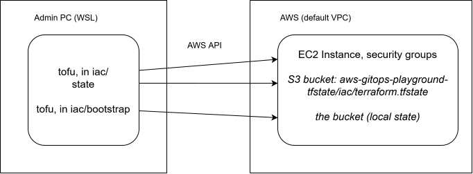

## Remote state in S3

A follow-up to Project 2, done after the service deployment phase. Until now OpenTofu's state lived in two files on my PC.

## Why move it

The state is OpenTofu's record of what it manages: which AWS objects belong to which resource in the config. With 10 resources (two instances, two security groups, six rules), keeping it on one PC had real weaknesses:

- **One copy on one disk.** If the PC broke or the folder was deleted, OpenTofu would forget what it manages. The servers would keep running, but every resource would have to be imported again.
- **No locking.** Two runs at once, for example from me and from a pipeline, could both write the state and corrupt it.
- **Nobody else can use it.** A teammate, or a workflow running `tofu`, has no access to a file on my PC.
- **It is not encrypted.** The state is plain text and contains, among other things, my home address from the SSH rule. `.gitignore` kept it out of the public repo, but that was the only protection.

## The usual setup

| Piece | Purpose |
|---|---|
| An S3 bucket as the backend | The state lives in one shared place |
| Versioning | Every earlier state is kept, so a bad change can be rolled back |
| Encryption | Stored files are encrypted at rest |
| Public access blocked | The bucket can never be made public by mistake |
| Locking | Only one run at a time. Older setups used a DynamoDB table. Recent versions lock with a small file in S3 itself. |

OpenTofu can additionally encrypt the state on my PC before it is uploaded, with a key I control. Terraform does not have this feature. Not used here.

## The chicken-and-egg problem

The bucket that holds the state cannot be created by the config whose state it holds. The bucket gets its own tiny config in a separate folder, `iac/bootstrap/`, with its own state kept locally. That local state describes only the bucket and three settings. If it were lost, re-importing them would take minutes.

Terragrunt, which I used at a previous job, solves this differently: its root file (`root.hcl`) defines the backend once for many configurations, names each state file after its folder, and can create the bucket itself. It pays off with many configurations and environments. Here there is one config, so a single backend block is the right size.

## 1. The bucket

`iac/bootstrap/version.tf` is a copy of `iac/version.tf` with the region written directly, because the bootstrap folder has no variables file. `iac/bootstrap/main.tf`:

```hcl
resource "aws_s3_bucket" "tfstate" {
  bucket = "aws-gitops-playground-tfstate"

  lifecycle {
    prevent_destroy = true
  }
}

resource "aws_s3_bucket_versioning" "tfstate" {
  bucket = aws_s3_bucket.tfstate.id
  versioning_configuration {
    status = "Enabled"
  }
}

resource "aws_s3_bucket_server_side_encryption_configuration" "tfstate" {
  bucket = aws_s3_bucket.tfstate.id
  rule {
    apply_server_side_encryption_by_default {
      sse_algorithm = "AES256"
    }
  }
}

resource "aws_s3_bucket_public_access_block" "tfstate" {
  bucket                  = aws_s3_bucket.tfstate.id
  block_public_acls       = true
  block_public_policy     = true
  ignore_public_acls      = true
  restrict_public_buckets = true
}
```

- Bucket names are unique across all of AWS, not just my account. The name appears in the committed config, so it does not include the account number.
- `prevent_destroy` guards the bucket, because losing it means losing the state.
- In current versions of the AWS provider, a bucket's settings are separate resources, not blocks inside the bucket.
- `AES256` means S3 encrypts with a key it manages.

**The public access block.** S3 has two mechanisms that can make something public: ACLs (an older, per-file and per-bucket permission system) and bucket policies (JSON rules on the bucket). For each, one setting stops a public grant being added and one neutralises any that already exists:

| Setting | Mechanism | Effect |
|---|---|---|
| `block_public_acls` | ACLs | Refuses requests that would add a public ACL |
| `ignore_public_acls` | ACLs | Treats any existing public ACL as if it were not there |
| `block_public_policy` | Bucket policies | Refuses a policy that would allow public access |
| `restrict_public_buckets` | Bucket policies | If such a policy exists, only AWS services and my own account can use the bucket |

AWS turns these on by default for new buckets. Writing them out states what the setup relies on, and if someone switched them off in the console, the next plan would show the difference.

```bash
cd iac/bootstrap
tofu init
tofu plan     # 4 to add
tofu apply
aws s3 ls | grep tfstate
```

## 2. Moving the state

A copy of the local state first, outside the repo, as a safety net:

```bash
cp terraform.tfstate ~/tfstate-backup-before-s3.tfstate
```

The backend block, inside the `terraform { }` block of `iac/version.tf`:

```hcl
  backend "s3" {
    bucket       = "aws-gitops-playground-tfstate"
    key          = "iac/terraform.tfstate"
    region       = "eu-central-1"
    encrypt      = true
    use_lockfile = true
  }
```

- `key` is the file's path inside the bucket. Naming it after the folder leaves room for other configs to have their own state later, the same pattern Terragrunt automates.
- `encrypt` asks S3 to encrypt the file on upload.
- `use_lockfile` writes a small lock file next to the state during a run, so a second run waits.

```bash
cd iac
tofu init -migrate-state    # answered yes to copying the existing state into the new backend
tofu plan                   # No changes
```

## 3. Checks

| Check | Result |
|---|---|
| The state is in the bucket | `aws s3 ls s3://aws-gitops-playground-tfstate/iac/` lists `terraform.tfstate` |
| Encrypted at rest | `aws s3api head-object ... --query ServerSideEncryption` returns `AES256` |
| OpenTofu uses the bucket | The backend recorded in `.terraform/terraform.tfstate` is `s3` |
| Nothing lost | `tofu state list` shows the same 10 resources, each pointing at the same AWS object as in the backup |
| Nothing changed in AWS | `tofu plan` reports no changes |

The copy in the bucket started a new history (internally a new "lineage", numbered from 1) instead of continuing the old file's. It describes exactly the same resources. It only means that pushing the old backup back into the bucket would be refused at first, because OpenTofu treats them as different histories.

Afterwards the two local files in `iac/` were no longer used: `terraform.tfstate` was left empty, and `terraform.tfstate.backup` was the copy made during the move. Both were deleted. The only local state left is the bootstrap's, on purpose.

## Architecture

Only the admin path changes: OpenTofu on my PC still talks to AWS's API, and now reads and writes its state in the bucket instead of on my disk.


