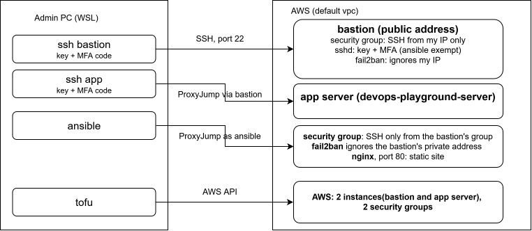

This is a DevOps project inspired from [roadmap.sh: Bastion Host](https://roadmap.sh/projects/bastion-host)

## Bastion Host
*The goal of this project is to learn and practice how to set up a bastion host—a secure entry point that enables authorized users to access private infrastructure or internal systems without exposing them to the public internet.*

*A bastion host is a server specifically designed to act as a secure gateway between external users and a private network. It reduces the attack surface of your infrastructure by being the only publicly accessible server, ensuring that all external connections go through a single, well-secured entry point. Typically, bastion hosts are configured to allow secure SSH or RDP access and are heavily monitored..*

## How it works

A bastion host is a second, separate server. It runs no application. Its only job is to accept SSH from me and pass the connection on to the server that does the real work.

```
Before:  laptop ──SSH──> app server
After:   laptop ──SSH──> bastion ──SSH──> app server
```

After the change, the app server refuses SSH from everywhere except the bastion. The private keys stay on the laptop. The bastion only relays the connection and never holds a key.

## Design decision

The server built in Projects 1 to 3 (`devops-playground-server`) becomes the private server. The bastion is a new instance in the same VPC.

"Private" here applies to SSH, which is the administrative access. The server keeps its public address, because it will later serve a website on port 80 and a server in a private subnet cannot be reached by visitors without a load balancer in front of it. A private subnet also needs a NAT Gateway for outbound traffic, which costs money for as long as it exists. That setup is left as an optional exercise for later.

## Infrastructure in code (`iac/`) part 2: Bastion server focussed

### 3. Adding the bastion

A connection is checked against the security group of the instance receiving it. With a bastion there are two connections, so two checks:

| Check | Connection | Group that decides | Rule |
|---|---|---|---|
| 1 | Laptop to bastion | The bastion's group | SSH from my address |
| 2 | Bastion to app server | The app server's group | SSH from the bastion |

New in `security.tf`: the bastion's group, its SSH rule from `var.admin_cidr`, its outbound rule, and the rule for check 2:

```hcl
resource "aws_vpc_security_group_ingress_rule" "allow_ssh_from_bastion" {
  from_port                    = 22
  to_port                      = 22
  ip_protocol                  = "tcp"
  security_group_id            = aws_security_group.this.id
  referenced_security_group_id = aws_security_group.bastion.id
}
```

`security_group_id` is whose list the rule is added to. `referenced_security_group_id` is who it lets in, here "any instance wearing the bastion's group". It does not depend on the bastion's address, so it keeps working when the bastion is rebuilt.

New in `main.tf`: a second `aws_instance` named `bastion`, with the current Ubuntu 26.04 image (looked up through SSM as in Project 2 and written as a literal), the same key pair and subnet, and the bastion's group. `outputs.tf` gained the bastion's public address and the app server's private address.

```bash
tofu plan    # 5 to add, 0 to change, 0 to destroy
tofu apply
ssh -i ~/.ssh/devops-playground ubuntu@<bastion-public-ip>    # works
```

## Building the bastion with the roles

The bastion was set up only by the `base` and `ssh` roles. Nothing was configured on it by hand.

### 1. Groups in the inventory, two plays in the playbook

The bastion should get `base` and `ssh`, but not `nginx` and `app`. `inventory.ini`:

```ini
[app]
my_host_01 ansible_host=<app-address> ansible_user=ansible server_hostname=devops-playground-server

[bastion]
bastion_01 ansible_host=<bastion-public-ip> ansible_user=ansible server_hostname=devops-playground-bastion

[myhosts:children]
app
bastion
```

`[myhosts:children]` makes `myhosts` a group of groups. Both servers are still inside it, so everything in `group_vars/myhosts/` keeps applying to both.

`setup.yml` now has two plays: `hosts: myhosts` with `base` and `ssh`, and `hosts: app` with `nginx` and `app`.

```bash
ansible-playbook -i inventory.ini setup.yml --list-hosts     # play 1: both hosts, play 2: my_host_01
ansible-playbook -i inventory.ini setup.yml --limit app      # ok=25, changed=1
```

`ask_vault_pass = True` was added under `[defaults]` in `ansible.cfg`. Every command that targets these hosts loads the encrypted vault file, so every command needs the vault password, including a plain `ping`. With this setting Ansible always prompts and the `--ask-vault-pass` flag is no longer needed.

### 2. Gap: the accounts had no password

On the app server, `dev` and `ansible` have passwords that I typed by hand, and `sudo` asks for them. The role created accounts without one, so on a fresh server neither account could have used `sudo`.

In the vault:

```yaml
ssh_user_passwords:
  dev: "<password>"
  ansible: "{{ ansible_become_password }}"
```

In the `user` task of the `ssh` role:

```yaml
    password: "{{ ssh_user_passwords[item.name] | password_hash('sha512') }}"
    update_password: on_create
  loop: "{{ ssh_users }}"
  no_log: true
```

- `ssh_user_passwords[item.name]` looks up the password for the user the loop is on.
- `password_hash` converts it, because Linux stores only a scrambled form of a password and the module expects that form.
- `update_password: on_create` sets the password only when the account is created, so existing accounts are untouched.
- `no_log: true` stops Ansible printing the task's values. Its output shows as censored.

Against the app server: `ok=5`, nothing changed.

### 3. First run, as `ubuntu`

A fresh instance has only the `ubuntu` account, and it accepts only the `devops-playground` key. The ssh-agent on WSL held only the `ansible` key, so the personal key was added with `ssh-add ~/.ssh/devops-playground`.

One reorder in the `base` role first: "Set hostname" now comes after the two `/etc/hosts` tasks. Changing the hostname before `/etc/hosts` knows the new name would recreate the slow `sudo` problem from Project 3 in the middle of the run.

```bash
ansible-playbook -i inventory.ini setup.yml --limit bastion -e ansible_user=ubuntu
```

`-e ansible_user=ubuntu` overrides the inventory's `ansible_user=ansible` for this one run. `ubuntu` has passwordless `sudo` on AWS images, so no account password is needed.

### 4. Gap: `/run/sshd` was missing

The first run stopped at the sshd task: `ok=16, changed=11, failed=1`.

```
failed to validate ... Missing privilege separation directory: /run/sshd
```

sshd's config test needs that folder. On Ubuntu it exists only while the ssh service is running, and at that moment on the bastion the service was stopped, because the package upgrade earlier in the same run had upgraded `openssh-server`. Because the test failed, Ansible did not write the file, so nothing about SSH had changed.

This was checked afterwards on the bastion:

```bash
systemctl cat ssh.service | grep -i RuntimeDirectory
# RuntimeDirectory=sshd    <- systemd creates /run/sshd when the service starts and removes it when it stops

grep -B3 -A8 openssh /var/log/apt/history.log
# Start-Date: 2026-10-12  12:43:17   dist-upgrade, including openssh-server

sudo journalctl -u ssh.service --since "2026-10-12" | grep -iE "stop|start"
# 14:43:18  Stopped ssh.service      <- one second into the upgrade
# 14:48:19  Started ssh.service      <- five minutes later, at the rerun
```

The two logs show the same moment two hours apart. The apt log was written while the server was still on UTC, and `journalctl` displays times in the server's current timezone, which the role set to Europe/Berlin later in that run.

The service stayed stopped for those five minutes because Ubuntu starts ssh on demand, when a new connection arrives. Ansible kept using the connection it already had open, so nothing triggered a start until the rerun connected again. Existing sessions are not cut off when the service stops, which is why the run could carry on at all.

Fix, a task directly before the sshd task so the test no longer depends on the service's state:

```yaml
- name: Create /run/sshd directory
  ansible.builtin.file:
    path: /run/sshd
    state: directory
    owner: root
    group: root
    mode: '0755'
```

Rerun with the same command: `ok=19, changed=3` (apt cache, the sshd file, the handler).

### 5. Proof run

```bash
ansible-playbook -i inventory.ini setup.yml --limit bastion
# ok=18, changed=1 (apt cache only)
```

Without the override, Ansible logs in as the `ansible` account the roles created and uses `sudo` with the password from the vault. Logging in as `dev` and running `sudo whoami` returned `root`. The two roles built a working server from an empty image, and running them against a fresh server found two gaps that the hand-built server had been hiding.

## Switching the access path

The order was: add the new path, test it, and only then remove the old one.

### 1. `ProxyJump` by hand

`~/.ssh/config` on WSL (a file, with `chmod 600`):

```
Host bastion
    HostName <bastion-public-ip>
    User dev
    IdentityFile ~/.ssh/devops-playground

Host app
    HostName <app-private-ip>
    User dev
    IdentityFile ~/.ssh/devops-playground
    ProxyJump bastion
```

`ProxyJump bastion` means "to reach `app`, first connect to `bastion` and tunnel through it". Both logins use the key on my laptop. The key is never copied to the bastion. The app server is addressed by its private address, which does not change when the instance restarts.

**Why `ssh app` asks for the passphrase twice.** With `ProxyJump` the PC makes two separate logins, one to the bastion and one to the app server through it, and each uses the key. Unless the key is already unlocked in the ssh-agent, `ssh` decrypts the key file each time and asks each time. `ssh bastion` is one login, so it asks once. Loading the key with `ssh-add ~/.ssh/devops-playground`, or adding `AddKeysToAgent yes` at the top of `~/.ssh/config`, leaves only the MFA code.

```bash
ssh bastion
ssh app
echo $SSH_CONNECTION    # on app: the first address is the bastion's private address
```

### 2. Ansible through the bastion

On the app server's inventory line, `ansible_host` became its private address and this was added:

```
ansible_ssh_common_args='-o ProxyJump=ansible@<bastion-public-ip>'
```

```bash
ansible app -i inventory.ini -m ping                          # pong
ansible app -i inventory.ini -b -m command -a "id -u"         # 0
```

### 3. fail2ban exception per group

After the switch every SSH connection to the app server comes from the bastion, so that is the address it must never ban. `group_vars/app/vars.yml`:

```yaml
fail2ban_ignoreip: "127.0.0.1/8 ::1 <bastion-private-ip>"
```

A value in a child group (`app`) overrides the same variable from its parent group (`myhosts`). The app server gets this value, and the bastion keeps my home address from the vault.

```bash
ansible-playbook -i inventory.ini setup.yml --limit app --tags base    # ok=16, changed=4
sudo fail2ban-client get sshd ignoreip                                  # the bastion's private address
```

### 4. Removing the direct rule

With a second `ssh app` session open as a fallback, the `allow_ssh` rule on the app server's group (SSH from `var.admin_cidr`) was removed from `security.tf`. The plan must list only that one rule to destroy. The outbound rule stays: it is what lets the server download packages, and it has nothing to do with the way in.

This step is reversible even without a login, because the security group sits outside the server. Putting the rule back and applying restores direct access.

## Result

| Test | Result |
|---|---|
| `ssh -o ConnectTimeout=10 dev@<app-public-ip>` | `Connection timed out` |
| `ssh app` | Works, through the bastion |
| `ansible app -i inventory.ini -m ping` | `pong`, through the bastion |

The app server accepts SSH only from the bastion. A timeout is what a security group block looks like, as opposed to the `Connection refused` from fail2ban in the incident above.

Both servers and their security groups are described in OpenTofu, and everything inside them is described in Ansible.

## Open items

- A rebuilt bastion gets new public and private addresses. `inventory.ini`, `~/.ssh/config` and `group_vars/app/vars.yml` then need updating.
- My home address can change. `terraform.tfvars` and the `fail2ban_ignoreip` value in the vault then need updating.
- The full package upgrade runs on every `base` run, so a problem at Ubuntu's archive blocks unrelated changes. It could get its own tag.
- `variables.tf` still has five unused variables from the old EKS project, and two resource names are misleading (`this`, `allow_http`). Renaming needs `moved` blocks.
- A committed `terraform.tfvars.example` would show anyone cloning the repo which value they must supply.
## Stretch goals (not done yet)

### Destroy and rebuild the bastion

The bastion is built entirely from code, so it can be removed between sessions to save cost and brought back when needed. This has not been run yet. The outline:

**Destroy.** `tofu destroy` on the whole folder is refused, because `prevent_destroy` protects the app server. Only the bastion instance is destroyed:

```bash
tofu destroy -target=aws_instance.bastion
```

The security groups and rules stay. They cost nothing, and the "SSH from the bastion's group" rule is then already in place for the next bastion. While the bastion is gone there is no SSH path to the app server. The fallback is to put the direct rule back in `security.tf` and apply.

**Rebuild.**

1. `tofu apply`. The new instance has a new public address, a new private address and a new host key.
2. `tofu output` for the public address, then one login by hand as `ubuntu` to accept the new host key. Ansible's jump connection needs that.
3. Update the public address in three places: the `bastion_01` line in the inventory, the `ProxyJump=` value on the app server's line, and `Host bastion` in `~/.ssh/config`.
4. Build it with the roles, first with `-e ansible_user=ubuntu`, then the proof run without it.
5. Update the private address in `group_vars/app/vars.yml` and apply with `--limit app --tags base`, so fail2ban on the app server exempts the new bastion.
6. Test `ssh app` and the Ansible `ping`.

Step 5 is the fragile one. Until it is done, three failed logins through the new bastion would get it banned on the app server for an hour, with no other way in. Giving the bastion a fixed private address in OpenTofu (`private_ip` on the instance) removes that step. Changing that setting replaces the instance, so the time to add it is just before a rebuild.

### Multi-factor authentication on the bastion (done)

From the roadmap's stretch goals. A login to the bastion used to need one thing, the key. It now needs the key and a six-digit code from an authenticator app that changes every 30 seconds. A stolen key alone is no longer enough.

Only the bastion needs this. It is the single way in, so the code is asked once there, and `ssh app` asks for it at the first hop.

**What had to be true first**, checked on the bastion:

```bash
apt-cache policy libpam-google-authenticator
# Candidate: a version number, so the package is available on Ubuntu 26.04

grep -n -E "common-auth|KbdInteractive|UsePAM" /etc/pam.d/sshd /etc/ssh/sshd_config
# /etc/pam.d/sshd:4:@include common-auth          <- asks for the account password
# /etc/ssh/sshd_config:85:KbdInteractiveAuthentication no   <- sshd will not ask typed questions
# /etc/ssh/sshd_config:108:UsePAM yes             <- sshd already hands logins to PAM
```

**1. A switch, so the same role behaves differently per server.**

```yaml
# roles/ssh/defaults/main.yml
ssh_mfa_enabled: false

# group_vars/bastion/vars.yml
ssh_mfa_enabled: true
```

Every MFA task carries `when: ssh_mfa_enabled`. `when` is a condition at the task level: the task runs only on hosts where it is true and shows as `skipping` elsewhere.

**2. Install the package** with `ansible.builtin.apt`. It puts the code-checking module and the enrolment command on the disk. Nothing uses them yet.

`ansible.builtin.package` would also have worked. It is the generic module that picks the server's own package manager and offers only the common options. `apt` is specific to Debian and Ubuntu and has apt's own options.

**3. Enrol `dev`, by hand.** This part is personal to me and my phone. On the bastion, as `dev`, without `sudo`, so the secret file lands in `dev`'s home folder:

```bash
google-authenticator
```

Time-based tokens: yes. Scan the QR code with the app, confirm with a code, save the file, disallow reuse of a code, keep the default time window, enable rate limiting. The command also prints five one-time scratch codes for when the phone is unavailable. They are stored in my password manager. The QR code, secret key and scratch codes must never be shared.

```bash
ls -l ~/.google_authenticator
# -r-------- 1 dev dev ...
```

**4. Enforce it**, with four tasks at the end of `roles/ssh/tasks/main.yml`:

```yaml
- name: stop the login system asking for the account password
  ansible.builtin.lineinfile:
    path: /etc/pam.d/sshd
    regexp: '^#?@include common-auth'
    line: '#@include common-auth'
  when: ssh_mfa_enabled

- name: Request MFA token for SSH login
  ansible.builtin.blockinfile:
    path: /etc/pam.d/sshd
    insertafter: '^#@include common-auth'
    block: |
      auth required pam_google_authenticator.so nullok
      auth required pam_permit.so
  when: ssh_mfa_enabled

- name: Configure sshd to use MFA
  ansible.builtin.copy:
    dest: /etc/ssh/sshd_config.d/20-mfa.conf
    owner: root
    group: root
    mode: '0644'
    validate: /usr/sbin/sshd -t -f %s
    content: |
      KbdInteractiveAuthentication yes
      AuthenticationMethods publickey,keyboard-interactive

      Match User ansible
          AuthenticationMethods publickey
  notify: Restart ssh
  when: ssh_mfa_enabled

- name: Test sshd config before restarting
  ansible.builtin.command: /usr/sbin/sshd -t
  changed_when: false
  when: ssh_mfa_enabled
```

What each part does:

- The first task comments out the line that makes the login system ask for the account password.
- `blockinfile` manages a group of lines as one unit. The first line asks for the code. `nullok` lets an account that has not enrolled yet log in with its key alone, which a freshly rebuilt bastion needs so that `dev` can get in to enrol. The second line makes that "skip" count as a pass.
- In the sshd file, `KbdInteractiveAuthentication yes` allows typed questions, and `AuthenticationMethods publickey,keyboard-interactive` means a login needs the key and then the typed answer.
- The `Match User ansible` block is the exception for the automation account. Ansible logs in unattended and also jumps through the bastion, so it cannot type a code.
- `validate` only tests the new file alone. The last task tests the whole sshd config with all files together. If it fails, the run stops and the handler never restarts ssh, so the running service keeps its old settings.

**Run and result.** Two extra sessions to the bastion were kept open as a fallback.

```bash
ansible-playbook -i inventory.ini setup.yml --limit bastion --tags ssh
# ok=11, changed=4 (password line, code block, sshd file, restart)
```

| Test, from a new terminal | Result |
|---|---|
| `ssh bastion` | Asks for `Verification code:`, then logs in |
| `ssh app` | Asks for the code at the bastion hop, then reaches the app server |
| `ansible all -i inventory.ini -m ping` | `pong` for both servers, no code asked |

The undo, from an open session, would have been to delete `/etc/ssh/sshd_config.d/20-mfa.conf` and restart ssh.

**Limits to know:**
- `nullok` means an account without a secret file is not asked for a code. A new human account must be enrolled, or it has key-only access.
- The `ansible` account is exempt, so its key is a key-only path through the bastion. That key has a passphrase and exists only on my machine.
- The secret lives on the bastion's disk. A rebuilt bastion loses it, and `dev` has to enrol again. Putting the secret in the vault and having the role restore it would remove that step.

### More granular traffic filtering

From the roadmap's stretch goals. One candidate: restrict UFW on the app server to SSH from inside the VPC only, as a second layer behind the security group.

## Architecture at the end of this phase



| Perspective | At this point |
|---|---|
| Visitor | Nothing is public. |
| Developer | Unchanged: the static site. |
| Admin | Every login to the app server goes through the bastion, by hand or with Ansible. Direct SSH to the app server was removed. The bastion was built only by the roles, from an empty image. The default `ubuntu` account still existed on both servers at this point. It was removed in the service deployment phase. |
